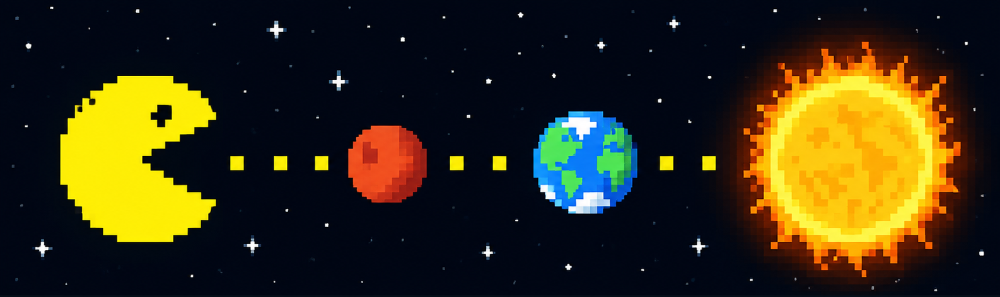

### I'm a design engineer based on NJ/NYC/PA. I'm open to remote!

<!--### Hi, I’m Erika!👋

***

**I'm a Data-Driven Designer/Developer based on New Jersey.**
	
- ✨ I'm currently looking for awesome team to work together! ✨
- 🎯 I use daily: `API`, `.py`, `.ipynb`, `.csv`, `.html`, `.css`, `.js`, `.sqlite`, `.sql`, `.sav`, `.xlsx`, `.twbx`, `.json`
- 🌱 I'm currently exploring more on: **React**, **Node**, **AWS**
- 💬 Ping me about: **Graphic Design**, **Web Design**, **Art**, **Resident Evil Series**
- 🎨 Love: `.psd`, `.ai`, `.indd`
- 💜 I'm spirited about: **Gaming**, **Resident Evil Series**, **Monster Hunter**, **My Buddy 🐶Koco**
- 😆 Passionate in helping others to build, to create, and to design codes! 

**Discover me on social media:**

<!-- - 💼 Connect me on [Linkedin](https://linkedin.com/in/erikayidesign "Linkedin") -->
<!--- 🌐 My Github Portfolio: [Portfolio](https://erikayi.github.io "Portfolio")
- 📊 My Tableau Page: [Tableau](https://public.tableau.com/profile/erika.yi "Tableau")
- 🦜 Join me talking about daily Tech, Olympics, Gaming, and K-pop: [Twitter](https://twitter.com/erikayi_dev "Twitter")
- 📧 Feel free to reach me at <erikayidesign@gmail.com> or [Twitter](https://twitter.com/erikayi_dev "Twitter") 

<!---
erikayi/erikayi is a ✨ special ✨ repository because its `README.md` (this file) appears on your GitHub profile.
You can click the Preview link to take a look at your changes.
--->
